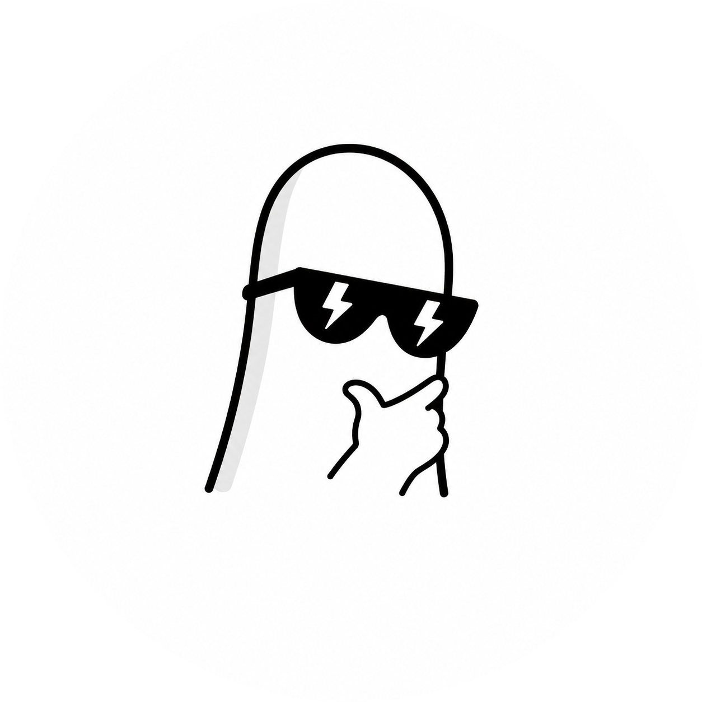

 

    

    Software Engineer &middot; Flutter &middot; Go &middot; Cloud &middot; <a href="https://karloos.dev">karloos.dev</a>

    
    
    
    

     
    

    <h3>
        
        Welcome to my GitHub
        
    </h3>
    <table>
        <tr>
            <td> Currently working on</td>
            <td><strong>AI-related projects</strong></td>
        </tr>
        <tr>
            <td> Learning</td>
            <td><strong>DevOps</strong></td>
        </tr>
        <tr>
            <td> Ask me about</td>
            <td><strong>Software Engineering</strong></td>
        </tr>
        <tr>
            <td> Find my work</td>
            <td><a href="https://github.com/karloows">GitHub</a> & <a href="https://karloos.dev">Portfolio</a></td>
        </tr>
        <tr>
            <td> Reach me</td>
            <td><a href="mailto:hello@karloos.dev">hello@karloos.dev</a></td>
        </tr>
        <tr>
            <td> Fun fact</td>
            <td><strong>I talk to dumbbells regularly</strong> 💪</td>
        </tr>
    </table>

 

<h2 align="center">Tech Stack</h2>

    
    
    
    
    
    

    
    
    
    
    
    

    
    
    
    
    

    
    
    
    
    
    
    

    
    
    
    

    
    
    

    
    
    

<h2 align="center">Featured Projects</h2>

    <table>
        <tr><td></td><td></td></tr>
        <tr><td></td><td></td></tr>
    </table>

 

    
    

 

    

<h2 align="center">
    Code  Cycle
</h2>
 

    
    
    
    
    

   

    
     
    Feel free to <strong>Contact</strong>, <strong>Connect</strong>, and <strong>Collaborate</strong>.
     
    <i>Karloos <a href="https://karloows.github.io">@karloows</a></i>

